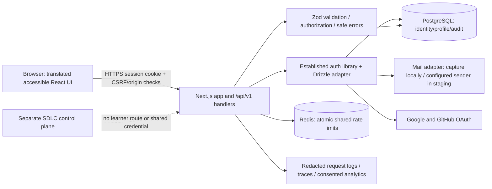
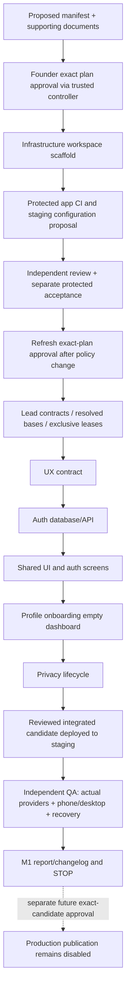

# M1 architecture — proposed

Specification §§7–9/12; ADR-002/003/010–013/016. Implementation remains gated. Verify supported versions and APIs against official primary documentation at approved implementation time, pin them in the lockfile, and record decisions. No package-version or provider-support claim is established by this plan.

## Runtime

The dotted boundary means administrative deployment relationship only, not application access to the controller. Learner requests cannot invoke agents, inspect repository/ledger state, mutate code, retrieve private PDFs or access model/deployment credentials. No student coach exists in M1. Docker input allowlists and runtime network/service accounts enforce separation.

`apps/web` owns pages, versioned handlers and server modules. `packages/db` owns the sole schema/migration sequence; `packages/ui` shared primitives/tokens and Storybook; `packages/i18n` English UI/email/a11y catalogues. Declare later packages only when build layout requires them, without algorithm/lab/admin implementation. Server-only code never enters client bundles. Prisma is not introduced alongside the selected Drizzle implementation.

## Delivery

Every implementation submission independently reviewed before integration; final QA supplements rather than replaces per-task review. Controller integration resolves actual commits. A changed contract, policy, spec, candidate or plan invalidates corresponding approvals/evidence according to current runtime.

## Identity model and migration proposal

Use supported auth library schema generator/adapter for exact field names and token storage. Logical entities and invariants:

| Entity | M1 fields and rules |
| --- | --- |
| User | Stable library ID, email uniqueness under documented normalization, name if required, verified status and UTC timestamps. No manual email case rules that diverge from adapter |
| Profile | One per user, background union, level union, goal union, nullable interview date, locale `en`, onboarding `not_started/completed/skipped`, updated timestamp/version for concurrency |
| Provider account/credential | Library-owned password hash/provider identifier, unique provider-account key and user linkage; linking requires supported verified identity/recent authentication policy |
| Session | Library-owned user/session identifiers, expiration/revocation, secure cookie references; revoke all relevant sessions on reset/deletion |
| Verification/reset | Library-supported protected expiring single-use tokens. Never store raw token values in logs/events or handoff artifacts |
| Audit | Pseudonymous actor/target IDs, action, timestamp, safe outcome/correlation ID. Minimal retention and deletion treatment documented; no sensitive payloads |

Only schema owner creates migration files. Test initial migration against empty DB, same migration chain against seeded account DB, uniqueness and FK constraints, concurrent writes and transaction failure. Keep mutable profile separate from historical audit. Profile concurrent update uses a version/updated-at precondition returning `409` for stale writes. Normal app role has no DDL privileges; separate migration role runs deploy migrations. Restore rehearsal verifies referential consistency and sessions. Use backup + compatible old image for rollback; incompatible schema requires write stop/isolated restore and reviewed recovery, not automatic destructive down migration.

No `labs`, versions, attempts, progress, purchases, entitlements, weaknesses or coach tables are implemented in M1. Future contracts preserve stable lab identity and immutable versioned evidence; M1 dashboard absence never becomes fake zero-valued mastery evidence.

## API and boundary contract

M1-LEAD-001 freezes precise TypeScript/Zod contracts before implementation. Proposed routes:

| Route | Contract |
| --- | --- |
| `/api/v1/auth/*` | Auth library bridge for signup/signin/signout, verification/resend, reset and Google/GitHub callbacks. Library response/session semantics documented; translate errors safely rather than breaking the library protocol |
| `GET /api/v1/profile` | Verified server session; return own editable profile only |
| `PATCH /api/v1/profile` | Verified session, Zod partial profile + expected version; no `user_id` authority; return normalized profile/version or typed conflict |
| `POST /api/v1/onboarding` | Verified session; discriminated `save` with background/level/goal/optional date, or `skip`; idempotent resulting status; no required date on skip |
| `GET /api/v1/dashboard` | Verified session; explicitly empty/not-yet-available learning sections; no fabricated scores or exposed other-user data |
| `GET /api/v1/privacy/export` | Recent authentication, own data only, attachment no-store, export rate limit and audit |
| `POST /api/v1/privacy/delete` | Recent authentication, confirmation, owner-only idempotent transactional deletion/revocation; supported library API for auth data |
| `GET /api/v1/health` | Minimal public liveness; separate private readiness verifies dependencies; no versions/secrets/connection strings leaked |

Application-owned responses use `{data: ...}` or `{error:{code,messageKey,requestId,fieldErrors?,retryAfterSeconds?}}`; codes and fields are typed. HTTP `400/401/403/409/429/503` represent validation/session/permission/conflict/limits/dependency failure. Error catalogues provide English presentation; never expose raw DB/provider errors. Auth endpoints retain necessary library protocol with documented safe mapping at UI boundary.

All routes validate size/type/input and session authorization, use method/CSRF/origin protections, per-user/per-origin rate limits and redacted request correlation. Anonymous authentication has shared limits plus accessible bot mitigation. Redis failure returns safe bounded retry error instead of bypassing limits. Profile identity always derives from session; client-supplied IDs never confer access. OAuth callback origin/state and account linking follow documented secure library configuration. Sign-out mutates via protected method, not cacheable GET. Production-grade CSP, secure HttpOnly/SameSite cookie settings and no-store sensitive responses are tested on HTTPS staging.

## Telemetry and privacy

Event envelope: `eventName`, `schemaVersion`, `occurredAt`, pseudonymous `actorId` where permitted, `requestId`, `environment`, `buildSha`, safe outcome/error code. No email/password/token, full IP, raw answer/form body or private corpus. Record minimal account-sharing security signals with retention/access control; avoid invasive fingerprinting. Optional product analytics requires consent; essential security/audit telemetry has separately documented purpose/retention. Do not infer marketing consent from signup. Export/delete cover M1 records and document backup retention/replay of deletion after restore. No user-data model-training pipeline or preselected opt-in.
