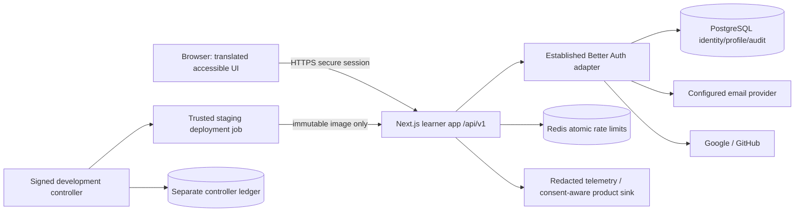
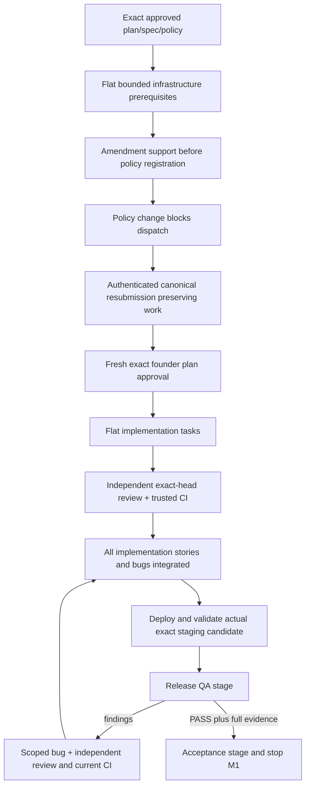

# M1 architecture and controller prerequisites

Planning only. Retain ADR-002/003 and accepted data/learning/delivery contracts; specification §§7–9,12,13,15–16. Pin supported versions using official docs during approved implementation; this plan does not assert current package APIs. Prototype stays unchanged, outside the new learner image. No application code, controller implementation or schema migration is authorized by this revision.

## Runtime

There is no learner-to-controller route, credential or network permission. The learner image contains no source corpus, tools, prompts, task ledger or model SDK. Coach/billing/admin/content engines remain absent. Runtime/migration roles are separate; secrets enter via managed store only, never prompts/browser/logs. Strict CSP, secure HTTP-only same-site cookies, library CSRF/origin/OAuth-state controls and safe internal redirects are required. Every route validates input, applies session authorization and shared atomic limits; Redis failure returns retryable denial rather than bypass. Signup adds accessible bot safeguards and bounded account-sharing signals. ASVS L2 control mapping and dependency scans are acceptance evidence, not a design assertion of compliance.

## Data and APIs

Only M1 identity entities: library user/credential/provider-account/session/verification-reset entities, profile and minimal audit. Respect documented pinned adapter schema. Unique provider identity and normalized email rules prevent unintended merges; account linking follows verified library-supported security policy. Tokens/passwords use established library protections, never custom crypto or product events. Profiles contain nullable background/level/goal/date, locale en, onboarding_state, version and timestamps; enums in UX.md bind API and DB. Atomic profile update uses expected version, audit and server-session owner. Schema/migration sequence has one writer (CODE-101/102); subsequent schema needs explicit lease transfer, not edits from privacy task.

| Interface | Input / output / boundary |
|---|---|
| `/api/v1/auth/*` | Library versioned bridge: signup/signin/signout/verify/resend/reset/OAuth; validated payload/config, safe mapped errors, replay/expiry controls |
| `GET/PATCH /api/v1/profile` | Session owner only; PATCH background/level/goal/interviewDate/locale/version; returns profile/version, 409 conflict preserves saved state |
| `POST /api/v1/onboarding` | action save or skip + validated fields/version; explicit persisted state, idempotent skip and optimistic conflicts |
| `GET /api/v1/dashboard` | Verified session; separate empty ownership/completion/mastery/review/weakness/streak/readiness; no fabricated tables or scores |
| `POST /api/v1/privacy/export` | Recent-auth owner, rate limited, no-store versioned export excluding secrets/provider credentials |
| `POST /api/v1/privacy/delete` | Recent-auth owner and explicit confirmation; idempotent transaction, session revoke, personal records removal, minimal retention and restricted deletion suppression |
| `/api/v1/health/live`, `/ready` | Minimal liveness vs dependency readiness, no connection/secret details; bounded limit independent of learner signin |

Safe error envelope `{error:{code,messageKey,fieldKeys?,retryAfterSeconds?,requestId}}`; never return raw stack/provider data. Statuses include 400 validation, 401 session, 403 verification/ownership, 409 version/link conflict, 429 rate, 503 dependency retry. Successful profile writes return versioned data; server ignores/rejects caller-selected user IDs. Audit is minimal actor/action/target/time. Telemetry schemas include pseudonymous ID/event/schema version/time/safe correlation; optional analytics disabled without consent. No email, IP, password, token or raw request/answer body in product events. Operational security telemetry has separately documented minimal retention/access.

Fresh and populated migrations must preserve identity; encrypted daily backup, isolated restore and deletion suppression replay precede reopening access. Binary rollback requires schema compatibility; incompatible migration stops writes and restores known backup. Recovery scripts record image/migration/backup IDs. Future immutable content versions/grant provenance/first-attempt evidence remain deferred, never fabricated M1 entities.

## Delivery

`user_stories` imports each child as an ordinary ledger story; parent `product_stories` are metadata. No nested task scheduler needed. QA and final acceptance are not items, dependencies or callable learner features. Existing `start_qa`, `create_bug`, `complete_qa`, `freeze_candidate` remain enforcing gates; OPS-106 adds controller scheduling regression coverage and stage artifact handling, not unfinished QA stories. Failed QA never marks implementation unfinished work as integrated; bug items must be independently reviewed/current-head CI/integrated before fresh candidate QA. Final acceptance cannot start until matching passed QA and cannot block its scheduling. Production freeze/approval/publication remains separate and excluded.

## Proposed amendment contract

OPS-101/102 must implement and independently verify authenticated `/sdlc amend-plan RELEASE PATH EXPECTED_OLD_HASH`. **Not supported in this checkout yet.** It is a policy-only exact rebind with byte-equivalent item IDs/titles/scope/dependencies; no additions/deletions or changed contracts. Trusted command reads committed plan and current spec/policy, validates paths/graph and compares ledger canonical scope before atomic CAS resubmission. `Control.amend_plan` preserves completed work and all counters/evidence history; clears active approval/QA/release certifications, retains integration SHA. No active leases; replay recovery must converge to one canonical stored plan/hash and one audited transition. Old-hash founder approval fails; new submitted hash can be approved by existing approve-plan command. A changed-contract amendment is rejected and escalated to a separately bounded capability, not run through destructive preimplementation revise-plan. CLI barriers apply to reconciliation/integration as well as worker execution. Supporting-document digests bind the exact design/test bytes in canonical plan.json.

## CI and staging seams

OPS-103 owns `automation/ci.py` and reconciliation; OPS-104 owns workflow dispatch; OPS-105 owns candidate validation. Proposed test seam `reconcile_checks(control,release_id,item_id,head,facts,requirements,actor)` accepts only facts fetched/verified by trusted API layer, not worker assertions; records aggregate failed/pending until every required current check passes. Requirements bind repository/PR/workflow identity/blob/job names; facts bind head/run/attempt/conclusion. Test seam `validate_candidate(candidate,transport)` compares trusted deployment inspect receipt before/after remote checks with commit/image/environment and rejects mismatches. These are proposed interfaces specified by executable tests, not existing capabilities. Tests must also exercise actual CLI/API wiring, not just the seams.

The proposed CLI amendment test contract is `cli.amend_plan(policy, control, path, expected_old_hash, authenticated_actor)`. It reads the trusted file rather than a worker-supplied hash. This helper must be shared by direct authenticated events and scheduled comment replay. Tests must demonstrate existing `current_plan` reflects the newly submitted canonical bytes and existing worker preflight permits progress only after fresh exact approval; an approved ledger old hash is not sufficient when recomputed policy hash changed.
