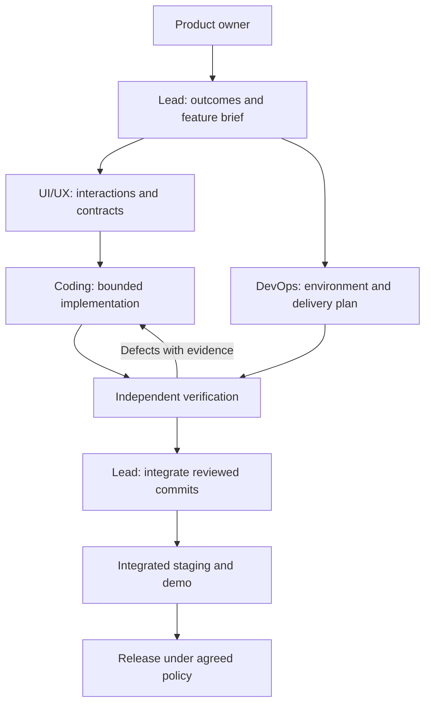

# EnterView: agent development harness and learning product plan

> Supersession note, 10 November 2026: `Systems Labs Product Specification.md` is now the product source of truth. Its M1–M8 sequence supersedes the roadmap and first assignments below. Use `../docs/AGENT_DEVELOPMENT_SYSTEM.md`, `../docs/plans/M1.md`, and `../agents/backlog.json` for current execution. Role isolation, task contracts and evidence principles remain applicable where consistent with the specification.

Status: proposed implementation plan, not an implemented agent runner.
Prepared: 5 November 2026.

## 1. Product outcome

Build a commercial software-engineering learning application in which students learn through diagrams, deterministic games, architecture drawing, interview practice, and source-grounded coaching.

The primary student journey is:

**Choose a skill → understand the mechanism → predict an outcome → experiment → sketch a design → defend a decision → review → revisit weaknesses.**

Sell individual labs and bundles. One lab has one identity and progress record regardless of which bundle grants access. Purchase ownership, activity completion, and demonstrated mastery are separate concepts.

### Current starting point

- Seven PDFs: 579 pages, 132 contents entries, 374 question pages.
- Local PDF ingestion, page-aware SQLite FTS5 retrieval, and a source inventory.
- One authored caching lab, 132 source-workshop templates, and three earlier animated demos.
- Hosted tutor integration exists; the available credential was rejected, so live generation remains unverified.
- Current persistence and Python development server are prototype components.
- This checkout has no `.git` directory. Establish a Git baseline before introducing isolated worker branches/worktrees.

Preserve useful behaviours and source metadata. Treat any frontend or backend framework migration as an explicit task with compatibility checks rather than a side effect of another feature.

## 2. Two separate systems

### Development harness

This system assigns work to development agents, manages isolated checkouts, runs checks, records evidence, integrates reviewed changes, and coordinates delivery. It runs outside the student application.

### Learning application

This system serves students, runs games, saves diagrams and attempts, enforces purchased access, retrieves learning evidence, and calls the embedded tutor. Development-agent state, credentials, and tools must not become student-facing capabilities.

The product's tutor has a constrained educational role. It cannot edit application code, deploy changes, run arbitrary student-supplied programs, or invoke the development harness.

## 3. Agent roles and ownership

| Role | Owns | Required outputs | Acceptance authority |
|---|---|---|---|
| Lead / product architect | Learning outcomes, scope, requirements, dependencies, architecture decisions, contracts, integration | Feature brief, task graph, acceptance criteria, decision log, release proposal | Accepts reviewed work against the feature brief |
| UI/UX designer | Learning journey, interaction storyboards, diagrams, game feedback, sketchpad UX, accessibility, design system | Screen/state specs, component contracts, responsive designs, content wording, design review findings | Verifies implemented interactions match the design |
| Coding engineer | Bounded application modules and appropriate verification | Isolated branch/commit, implementation, tests, evidence, migration notes where relevant | Cannot accept its own work as independently verified |
| DevOps engineer | Reproducible builds, CI, environments, deployment, observability, backups, recovery | Pipeline/environment definitions, staging evidence, runbooks, rollback/restore results | Verifies delivery and operational readiness |
| Independent QA / learning reviewer | Behaviour, regressions, educational correctness, source support, accessibility, purchase boundaries | Findings tied to acceptance criteria; exact-commit review verdict | Pass/fail validation gate; lead resolves scope disputes |

QA is a separate assignment and reviewer context, even when the same model family is used. It need not be a fifth concurrent worker.

### Model routing

- Choose models by demonstrated task capability, not by assigning a different brand to every role.
- The lead needs reliable planning, contract reasoning, and integration judgement.
- Coding needs repository navigation, multi-file implementation, debugging, and tool execution.
- UI/UX needs interaction reasoning and visual inspection of real screens.
- DevOps needs infrastructure and deployment reasoning with tightly scoped execution tools.
- QA needs adversarial test design, browser inspection, and learning-content review.
- Pin provider, model identifier, prompt version, and tool policy per run. Evaluate a small task suite before changing them.
- A first deployment can use one capable model with distinct role briefs. Add different models when measurements justify it.

## 4. The harness is a controlled workflow

Use a deterministic coordinator around agents. The lead proposes and prioritises work; the coordinator validates task schemas, enforces dependencies and permissions, schedules workers, and records state.



A feature's task states are:

`DRAFT → READY → RUNNING → SUBMITTED → REVIEWING → ACCEPTED → INTEGRATED → STAGING_VERIFIED → RELEASE_ELIGIBLE`

Alternative states: `REWORK`, `NEEDS_INPUT`, `CANCELLED`.

An agent declaring success moves work to SUBMITTED. Evidence and review determine acceptance. Integration or contract changes invalidate affected evidence until the integrated revision is checked.

### First-run capacity

Use one lead plus up to three active workers. UX and DevOps can work in parallel once requirements are ready. Coding starts once its interaction and interface contracts are sufficient. Schedule independent review when an implementation is submitted.

Do not parallelise tasks that both own the same dependency manifest, shared component foundation, or database migration sequence. Assign one owner to each shared surface.

## 5. Durable task and handoff contracts

Every assignment has an objective, dependencies, allowed paths, input versions, expected evidence, and enforced limits. Chat messages help collaboration; durable artifacts remain the source of truth.

Example task:

```json
{
  "task_id": "SKETCH-003",
  "run_id": "vertical-slice-001",
  "role": "coding",
  "objective": "Save and reload the student's architecture drawing",
  "spec_version": "sketchpad-v1",
  "depends_on": ["SKETCH-001", "SKETCH-002"],
  "base_commit": "<resolved commit SHA>",
  "branch": "agent/SKETCH-003",
  "allowed_paths": ["web/sketchpad/", "api/drawings/"],
  "acceptance_criteria": [
    "Reload preserves nodes, arrows, labels, and positions",
    "A failed save preserves the local draft and offers retry",
    "Another account cannot read or overwrite the drawing"
  ],
  "required_evidence": ["tests", "browser-demo", "diff-summary"],
  "limits": {
    "max_attempts": 2,
    "max_minutes": "<set in run configuration>",
    "max_tokens": "<set in run configuration>",
    "max_cost": "<set in run configuration>"
  }
}
```

Paths above illustrate a proposed module layout, not current directories. The coordinator must reject unresolved budget placeholders before executing a cost-bearing task.

Each submitted handoff includes:

- Task/run ID, exact commit SHA, base commit, spec and prompt versions.
- Changed paths and what the change accomplishes.
- Acceptance criteria mapped to verification results.
- Test logs, screenshots or recordings where relevant, and artifact paths.
- Known limitations and unresolved failures.
- Migration, configuration, or rollout implications.
- Resource usage and follow-up tasks.

### Proposed durable storage

Use a small task database with `runs`, `tasks`, `dependencies`, `events`, `artifacts`, `reviews`, and `usage` records. Store artifact hashes and locations, not large binaries in task rows. An append-only event log supports audit and restart recovery.

Workers heartbeat while active. A lease expiry marks the attempt interrupted; the coordinator resumes from a known commit/artifact checkpoint. Acquire a new task lease before retrying so two workers cannot unknowingly own the same attempt.

## 6. Workspace, permissions, and integration

1. Create a baseline repository commit from the reviewed prototype.
2. Give each modifying task a separate worktree/checkout and branch.
3. Enforce allowed-path ownership and tool policy in the coordinator, not just in prompts.
4. Coding workers submit commits; the lead is the integration owner.
5. Review the exact submitted revision. Recheck dependent contracts when code changes after review.
6. Run integrated browser and API journeys after merging into the integration branch.
7. Keep production credentials available only to authorised deployment jobs.

Ordinary development, automated checks, previews, and staging iteration should proceed under the agreed autonomy policy. For the initial commercial release, recommend product-owner release approval after a concrete staging demo; that policy can later be delegated explicitly. This is a proposed operating policy, not a request to approve planning work.

### Recovery and budget rules

- Bound retries for transient tool failures, with backoff and recorded reasons.
- After two unsuccessful implementation/review cycles, return findings to the lead for decomposition or a contract correction.
- Pause dependent work when requirements or shared interfaces change; do not silently reinterpret them.
- Resume interrupted work from artifacts and commits rather than reconstructing everything from conversation history.
- Record idempotency identifiers for external mutations such as deployment and purchase processing.
- Track development-agent spend separately from learner-tutor spend.

## 7. A reusable educational contract: LabSpec

Before coding a lab, define a versioned specification with:

- Learning objectives, prerequisites, target learner, and likely misconceptions.
- Scenario and explicitly labelled assumptions.
- Deterministic simulation state, inputs, transitions, and expected outcomes.
- Diagram components, animation controls, and accessible text/state alternatives.
- Student predictions, permitted experiments, and progressive hints.
- Sketchpad task and semantic architecture criteria where relevant.
- Practice prompt, assessment rubric, and worked explanations.
- Source document/page references and content version.
- Tutor evidence scope and hint/reveal policy.
- Separate activity-completion, mastery-evidence, and revision events.

The lead owns the learning outcomes. UX owns how students act and receive feedback. Coding implements the mechanics. QA checks whether those mechanics actually demonstrate and assess the intended concept.

Models may draft LabSpecs and explanations. Publish only validated content. Do not execute arbitrary model-generated HTML or JavaScript in the student application; use reviewed components and declarative lab definitions.

### Initial game families

| Concept | Interaction | Observable learning evidence |
|---|---|---|
| Caching | Predict hits/stale reads, expire a hot key, compare refill policies | Explains freshness versus database load and distinguishes jitter from coalescing |
| Load balancing | Route requests, vary backend capacity, fail a server | Chooses a routing policy and accounts for detection delay |
| Queues/backpressure | Vary arrival and processing rates | Recognises growing backlog and explains overload choices |
| Transactions | Interleave operations and inspect outcomes | Identifies an anomaly and justifies the required protection |
| Replication | Delay a replica, read from different locations | Explains freshness and availability trade-offs under the stated model |
| LLD patterns | Change a requirement and refactor a dependency graph | Defends an abstraction using the changed requirement |

Gamification should reward predictions, explanations, design improvements, and successful transfer to new scenarios. Experimentation and deliberate failure should remain safe. Optional timers support interview rehearsal. Points and streaks do not certify mastery.

## 8. Architecture sketchpad

### First version

- Free drawing plus a component palette: client, gateway, service, cache, database, queue, worker, and external dependency.
- Labelled directional connections, selection, move/resize, pan/zoom, undo/redo, and reset confirmation for unsaved work.
- Draft recovery, explicit save status, versioned persistence, and ownership checks.
- Editable scene export plus PNG/SVG export.
- A keyboard-accessible component/connection list alongside the canvas.
- A dedicated expanded canvas for complex work on small screens.
- Students can add assumptions and explain each important design decision.

Excalidraw is a candidate embedded editor. Its editor package documents drawing tools, bound/labelled arrows, undo/redo, and PNG/SVG/JSON export. Application-level persistence, ownership, lab integration, and semantic evaluation still belong to EnterView. See its [official README](https://github.com/excalidraw/excalidraw/blob/master/README.md).

### Store meaning separately from appearance

Keep a scene representation and an app-managed semantic model:

```text
DrawingScene: shapes, positions, styles, labels, editor version
ArchitectureGraph: typed components, connections, responsibilities, assumptions
Attempt: student, lab/content version, scene revision, explanation, assessment evidence
```

Structured palette actions can update both. Arbitrary freehand marks should not be assumed to have a reliable semantic meaning; students can map them to components or confirm an interpretation.

Architecture feedback should inspect responsibilities, connections, constraints, failure handling, and the student's explanation. Do not grade neatness or require one reference layout. A tutor may propose interpretations and ask clarifying questions; uncertain visual interpretation must not become a definitive failing grade.

Real-time collaboration and multiplayer drawing are later features. Reliable single-user saving and recovery come first.

## 9. Application architecture and commercial boundaries

Keep modules explicit even if initially deployed together:

1. **Web learning client:** lab player, diagrams/games, sketchpad, accessible navigation, progress UI.
2. **Application API:** identity, authorisation, attempts, diagrams, progress, purchases, entitlements.
3. **Content service:** versioned LabSpecs, source references, publication state, bundle composition.
4. **Retrieval/tutor service:** scoped evidence retrieval, citations, model invocation, usage limits, graceful fallback.
5. **Background ingestion:** parsing, content inventory, retrieval indexing, quality reports.
6. **Data stores:** transactional learner/purchase records; private assets and PDF storage; versioned retrieval index.

Choose production frameworks and hosting through a short architecture decision record once requirements and deployment constraints are agreed. The existing Python API contracts and deterministic simulations can inform a migration. An editor requiring a component framework may justify a frontend migration, but that should have its own acceptance criteria.

### Entitlements

Represent labs, bundles, purchases, and access grants explicitly. Enforce access on the server before delivering paid lesson payloads, student attempts, private drawings, or tutor evidence. A hidden frontend button is not an access boundary.

Use payment test mode for development. Verify signed events, duplicate delivery, retries, ordering, failed payments, and refunds. Snapshot or version purchased bundle membership according to the product's published update/access policy. Do not award completion because a student purchased a bundle.

## 10. QA and release gates

### Ready for implementation

- Requirements and learning objectives are measurable.
- Interaction states, source scope, interface contracts, and ownership are defined.
- No unresolved prerequisite blocks the task.

### Ready for integration

- Relevant checks pass against the submitted commit.
- Independent QA has reviewed the same revision.
- UI changes have desktop/mobile and keyboard evidence.
- Game outcomes are deterministic for defined inputs.
- Explanations have source support or clearly labelled illustrative assumptions.
- Saving failures, model failures, and recovery states preserve student work.

### Ready for release

- Integrated staging demonstrates the full student journey.
- Purchase/access, drawing ownership, and source filtering are verified server-side.
- Schema migrations and saved drawing versions are compatible with rollout/rollback.
- Logs, metrics, alerting, and backup/restore checks are in place.
- The live tutor has been tested separately from fixtures with valid credentials.
- Product and content versions are traceable to the release commit.

Routine CI uses model fixtures for repeatability and predictable cost. Live-model checks are a separately reported evaluation; a mocked response never counts as live-provider success.

## 11. DevOps delivery and operations

Proposed pipeline:

`Task branch → isolated CI → preview → integrated staging → release checks → production → post-release verification`

CI covers relevant simulation rules, save/load/export, account ownership, tutor scope/citations, purchase processing, migrations, and browser journeys. DevOps provides reproducible environments and identifiable build artifacts.

Use deployment environment isolation and the secret/protection features supported by the chosen CI account. GitHub documents environment secrets and protection rules, with availability varying by plan and repository visibility: [official environment guidance](https://docs.github.com/en/actions/how-tos/deploy/configure-and-manage-deployments/manage-environments).

Operational measurements:

- Lab load errors, simulation exceptions, diagram save failures, and draft recovery.
- API latency and errors, tutor availability, retrieval quality regression, model usage and spend.
- Purchase-processing failures, entitlement mismatches, and ingestion lag.
- Task throughput, rework rate, review defects, agent run failures, and cost per accepted task.

Avoid logging raw student answers, drawings, document excerpts, or credentials by default. Apply retention policies to the product and agent artifacts separately.

Use immutable release identifiers and compatible migrations. Retain a previous application and content/index version. Demonstrate restoration of learner data and private assets, not merely backup configuration. The lead and DevOps should agree recovery objectives before a paid launch.

## 12. Delivery milestones

| Milestone | Concrete result | Exit evidence |
|---|---|---|
| M0: baseline and harness | Git baseline, role briefs, task schema/state, isolated worker execution, artifact store | One bounded task survives interruption and produces a reviewed commit |
| M1: product foundations | LabSpec, interaction system, API contracts, student attempt/drawing persistence plan | An example LabSpec renders with accessible states and deterministic outcomes |
| M2: flagship vertical slice | Caching game → architecture sketch → explanation → source-grounded feedback → saved attempt | Complete desktop/mobile journey, recovery checks, source review, valid live-tutor test |
| M3: reusable lab families | Reusable caching, routing, queueing, and design interaction components; reviewed additional labs | Every published lab passes simulation and educational checks |
| M4: commercial pilot | Catalogue, single/bundle test purchases, entitlements, progress, staging operations | Purchase-to-learning flow plus refund/access checks and recovery demonstration |
| M5: measured expansion | More reviewed labs and role bundles, improved retrieval where evaluation shows gaps | Learner transfer/completion evidence and stable delivery/operating metrics |

Progress through exit criteria rather than claiming a fixed calendar before task sizing and capability testing.

## 13. First assignments

1. **LEAD-001:** Write the caching-plus-sketchpad feature brief, learner assumptions, outcomes, and acceptance criteria.
2. **UX-001:** Storyboard predict → play → sketch → defend → review; specify failure, mobile, keyboard, and reduced-motion states.
3. **OPS-001:** Establish baseline repository and repeatable local/CI checks; define preview/staging environment contracts.
4. **CODE-001:** Implement the versioned lab runner and deterministic event contract against approved interfaces.
5. **SKETCH-001:** Evaluate the editor integration and implement labelled components, draft recovery, save/load, and export.
6. **TUTOR-001:** Bind hints and critique to the active lab, scene/assumptions supplied by the student, and permitted source evidence.
7. **QA-001:** Independently exercise the full slice, including stale reads, refill comparison, drawing recovery, unsupported source questions, and model outage.
8. **LEAD-002:** Integrate accepted revisions, review the staging demonstration, and adjust the harness based on observed rework and gaps.

Only schedule parallel tasks after their contracts and ownership permit it. Do not dispatch all 132 source-workshop topics as autonomous lab-generation jobs before the flagship slice and publication gates work.

## 14. Decisions to record before implementation

These decisions need a concise recorded answer; they do not block the existence or review of this plan.

- Initial learner level and the first paid learning outcome.
- Provider/model routing and per-run budget values for the development harness.
- Source content cleared for the planned commercial use and the editorial owner.
- Git repository/CI account, deployment constraints, and production release policy.
- Drawing persistence/privacy and product access/update terms.
- Payment provider eligibility and purchase/refund policy for the target market.

The lead should resolve routine implementation choices within the agreed scope and bring only material product, spending, or externally consequential decisions to the product owner.
